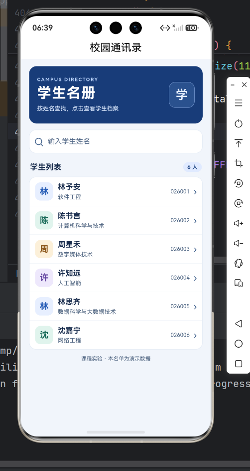
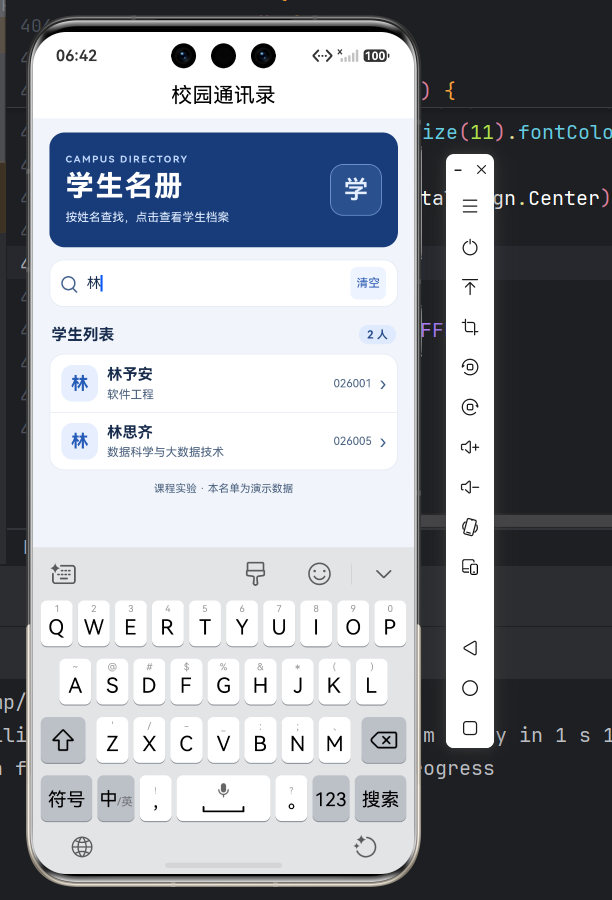

# 实验三 · 鸿蒙学生名册

使用 uni-app（Vue 3）开发，运行目标为 HarmonyOS。名册用虚构数据展示学生学号、姓名和专业，支持按姓名搜索、加载提示以及点击学生行查看详情。

## 鸿蒙模拟器运行截图

以下两张图来自 DevEco Studio 的 Mate 90 Pro 鸿蒙模拟器。

| 完整名单 | 按姓名搜索 |
| --- | --- |
|  |  |
| 加载完成后显示 6 名学生。 | 输入「林」，仅保留林予安和林思齐。 |

## 在 Windows 上运行

已运行环境为 HBuilderX 5.34（Vue 3 编译器）、DevEco Studio 26.0.0.851 和 Mate 90 Pro 鸿蒙模拟器。

1. 克隆仓库或下载源码，将文件放到短路径目录，例如 `D:\Stu`。确保该目录下直接有 `App.vue`、`manifest.json` 和 `pages.json`。
2. 在 HBuilderX 选择「文件 → 导入 → 从本地目录导入」，选择该目录，再打开项目中的 `App.vue`。不要直接把 Vue 源码目录当成原生 ArkTS 工程用 DevEco Studio 打开。
3. 在 DevEco Studio 的「设备管理器」启动鸿蒙模拟器，等它进入系统桌面。使用兼容镜像，建议 API 20 或更高。
4. 如果 HBuilderX 跳到「运行配置」，在「鸿蒙运行配置」里填写 DevEco Studio 的**安装文件夹**，例如 `D:\DevEco Studio`，不是 `bin` 或启动程序。
5. 回到 HBuilderX，选择「运行 → 运行到手机或模拟器 → 运行到鸿蒙」，选中模拟器。待控制台显示「运行包制作成功」「安装成功」「运行成功」，到模拟器手机屏幕查看「学生名册」。

### 常见问题

- **打包提示 `00306001` 或路径超过 259 个字符**。把源码移到类似 `D:\Stu` 的短路径重新导入。不要搬 `unpackage/`，HBuilderX 会重新生成。
- **日志提示未配置数字证书**。本实验使用的模拟器已验证能运行未签名的调试包。若改用真机，按设备提示配置自己的调试签名，不要提交证书。
- **需要查看生成的原生工程**。HBuilderX 调试运行后，可用 DevEco Studio 打开 `unpackage/dist/dev/app-harmony`。日常修改仍应在原始 uni-app 源码中完成。

参考 [DCloud 鸿蒙运行与发行指南](https://uniapp.dcloud.net.cn/tutorial/harmony/runbuild.html)。

## 功能验收

| 要求 | 操作与预期结果 | 实现 |
| --- | --- | --- |
| 信息列表 | 启动后显示 6 名学生的学号、姓名、专业 | 首页使用 `v-for`，以学号作为 key |
| 姓名过滤 | 输入「林」只显示 2 人，清空恢复 6 人，无匹配显示空态 | `input` 更新关键词，计算属性按姓名过滤 |
| 模拟加载 | 冷启动时约 1 秒内显示「正在加载学生信息…」 | `Promise` 配合 `setTimeout`，并通过条件渲染切换状态 |
| 详情跳转 | 点击林予安，详情显示学号 `026001` 和专业「软件工程」 | `uni.navigateTo` 带学号，详情页在 `onLoad` 读取参数 |
| 界面布局 | 搜索栏、学生行和详情卡片样式统一 | 使用 Flex 和 `rpx` |

## 关键文件

| 路径 | 说明 |
| --- | --- |
| `App.vue` 和 `main.js` | 应用入口及全局样式 |
| `manifest.json` 和 `pages.json` | 应用配置与页面注册 |
| `pages/students/students.vue` | 名册、加载、搜索、详情跳转 |
| `pages/student-detail/student-detail.vue` | 学生详情与返回 |
| `services/students.mjs` | 学生数据、异步加载、筛选与路由参数 |
| `screenshots/harmony-emulator/` | 两张鸿蒙模拟器运行截图 |
| `tests/students.test.mjs` | 数据与路由逻辑测试 |

可在源码根目录用 Node.js 执行 `node --test tests/students.test.mjs`。提交源码即可，无需提交本地打包产物和签名文件。
